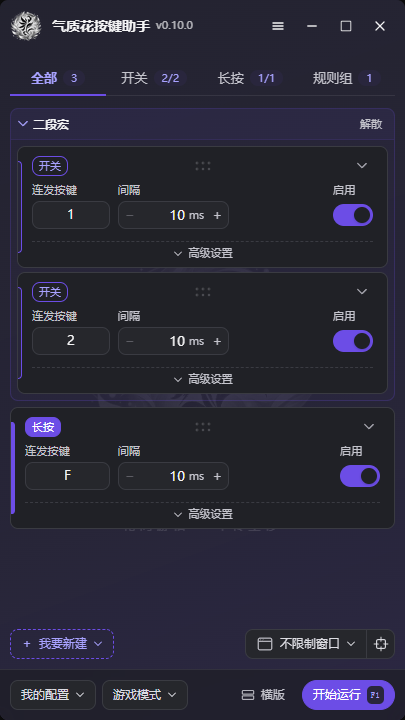
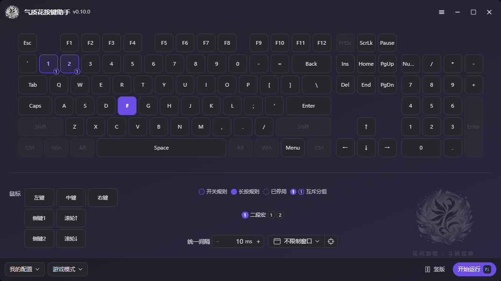

# 气质花 FlairBloom · PVE 打本按键小助手

**高颜值界面，21 套门派配色，明暗主题与多种布局随心切换。**

武学助手要一直按 F，手搓循环要反复戳键，多段宏还得来回切——把重复按键交给气质花，让手指歇一会儿。

面向剑网三 PVE，也适用于需要重复按键的普通软件。高颜值界面与核心按键功能永久免费，支持 Windows 10 / 11 的 64 位系统。

**下载与介绍：[官网](https://app.xwink.fun/flair-bloom/)** · **源码与反馈：[GitHub 仓库](https://github.com/x-wink/flair-bloom)**

**交流反馈 QQ 群：1127449168**

## 打本时，它能帮你做什么

- **武学助手 FFF**：设好 F 连发，省去一直戳键的动作。
- **长按等 CD**：按住一个键持续连发，适合手搓循环里的重复按键。
- **一键宏启动**：按一下开始持续触发，再按一下停止；也能单独设置停止键。
- **规则组**：常用于多段宏自动切换。同组只运行一条，长按可临时插队、松手恢复；新建默认加入按键 1、2 的两条停用切换规则，方便快速设置。
- **连发序列**：按顺序循环多个按键，每步单独设间隔；支持手动编辑与键盘点按录制。
- **查攻略、找宏**：剑网三专栏按门派与心法整理白皮书和宏，支持复制云端宏名；已获授权的宏正文也能直接复制。

气质花负责按你设置的规则重复按键，输出结果仍取决于技能、宏、装备和实际战斗。

## 高颜值界面，看着舒服，用着顺手

清爽的规则卡片、柔和的门派配色、连发时的呼吸高亮，让正在运行的按键一眼可见。明亮、深色与跟随系统三种外观模式，搭配统一风格的主面板、键鼠图和悬浮窗，按自己的习惯布置桌面。

**竖版规则列表**适合精细调整：连哪个键、多久一次、开关还是长按，都在卡片上。高级设置内可编辑、录制连发序列，修改自动保存；也能做「按住侧键连左键」「按 F 连滚轮」这样的组合。按键冲突会在卡片标题显示警告，悬停可查看原因。

  

**横版键鼠图**适合一眼看全：在键盘、鼠标示意图上点键，就能轮换开关规则、长按规则和取消；正在连发的键会亮起。

**悬浮窗**把面板收成一个可拖动的小条，能看正在运行的按键，也能直接暂停、恢复和展开面板。界面跟随显示器缩放，主面板可拖动边缘放大。

键盘、鼠标左／右／中键、侧键和滚轮都能配置。全局热键、语音提示、明暗主题与 21 套门派配色，也可以按习惯调整。

## 游戏里，先选对输入模式

| 模式                | 适合什么                                                                               |
| ------------------- | -------------------------------------------------------------------------------------- |
| **网吧模式**        | 方便快捷·无需重启。新装默认使用，需要管理员权限；支持同键开关规则与横版键鼠图。 |
| **游戏模式**        | 安全稳定·剑三推荐。首次安装驱动后必须重启 Windows，再以管理员权限启用。 |
| **轻量模式**        | 网页办公·游戏无效。无需安装驱动。 |

新装默认开启「以管理员模式启动」，按系统提示授权即可。出厂配置的全局开关默认绑定 **F1**；升级保留自定义快捷键和游戏模式选择；未绑定全局开关且 F1 未被占用的已有配置会补上 F1。轻量模式只迁移一次为网吧模式，之后仍可手动选回。

有外设驱动硬件时，检测并确认连接后才会显示「外设模式」，由硬件作为 USB 键鼠输出，无需管理员权限；没有硬件的用户不会看到这个选项。

安装完成不等于驱动已生效。游戏模式通道打不开或没有可用键盘时，应用会说明原因并临时回退轻量模式，保留原先选择；设备槽满或编号偏高只作诊断提示，不阻止仍可读取的键盘。新接设备失效时，请用「开始 → 电源 → 重启」，开启快速启动时，关机再开机不能代替这一步。

## 三步上手

1. 打开我要新建。选择开关或长按。
2. 录入连发按键。启用这条规则。
3. 点击开始运行。开关按一次启停。长按松手即停。

更多操作见[说明书](skills/flair-bloom/SKILL.md)。

## 换角色不用重设，旧配置也能搬过来

不同角色、心法各存一套配置，面板和托盘都能切换。规则与全局热键一起保存，也能导出成 `.qzh` 分享给朋友。

**我们的 `.qzh` 配置文件欢迎自行尝试解析，也欢迎编写兼容的导入、导出与转换工具。**

「导入配置」统一支持 **`.qzh`** 和**丐帮高手、衍天高手、极简按键、小叽按键**配置。扫描桌面、下载等默认位置，也会从已知助手的桌面快捷方式找到配置目录，管理目录之外的 `.qzh` 同样能发现，多档方案分别列出。也可选择文件或指定目录；选中后先看预览，再导入成新配置。

不能等价转换的动作会说明差异：双宏、多目标轮流执行等会跳过；极简的顺序循环、小叽随总开关自动启动的连发会转成默认停用的规则，确认触发方式后再启用。独立按压时长、暂停键和窗口限制也不会悄悄照搬。

## 用起来需要知道的几件事

**游戏里没有反应？** 先看全局开关和规则是否启用，再确认使用的是已生效的游戏模式。轻量模式不适合作为游戏内连发方案。

**启停异常怎么办？** 先关闭全局开关，必要时正常退出应用。停止、切配置、切模式和正常退出都会执行停连发与抬键清理。DD 同键启停仍可能误判，这些清理是兜底；强行结束进程无法执行退出清理。

**会自动更新吗？** 默认在后台检查并下载，完成后提示重启安装；可以在设置里关闭。当前版本的变化在「☰ → 更新公告」查看。

**会被游戏检测吗？** 气质花通过模拟按键工作，不修改游戏文件、不读取游戏内存，但仍存在被反作弊检测、拦截或处罚的风险，外设模式也一样。请结合游戏规则自行决定是否使用。

配置保存在本机。驱动诊断可导出报告，便于反馈安装、设备与显示环境问题；完整使用条款见应用内「☰ → 用户协议」。

## 亲友专属隐藏福利

兑换码解锁亲友专属隐藏福利，入口在「☰ → 兑换码」。

## 继续了解

更细的操作放在应用内教程和[使用说明书](skills/flair-bloom/SKILL.md)中；版本变化见 [CHANGELOG](CHANGELOG.md)。

配置和按键正文留在本机。统计随运行记录启动、正常退出、运行时长和横竖布局，不提供独立关闭入口；与引擎输出隔离。公开统计只显示累计数字，实际标识、用途和保留期见[用户协议](apps/main/src/assets/EULA.md#七使用统计与数据)。

## 接下来

想做、还没做的，按这里的顺序不一定：

- 按前台游戏自动切换对应配置，复用已实现的[窗口绑定](docs/roadmaps/archive/window-binding.md)识别与监听能力。
- 组合键触发与连发，例如按 `Ctrl+F` 连发 `Shift+1`（[评估草案](docs/roadmaps/key-chords.md)）。
- 界面迁到 Vue 与 xwink 组件库（[路线图](docs/roadmaps/vue-migration.md)）。

---

© 2026 x-wink · [CC BY-NC-SA 4.0](LICENSE)，注明作者可自由分发、禁止商用。第三方声明见 [THIRD_PARTY.md](THIRD_PARTY.md)。
